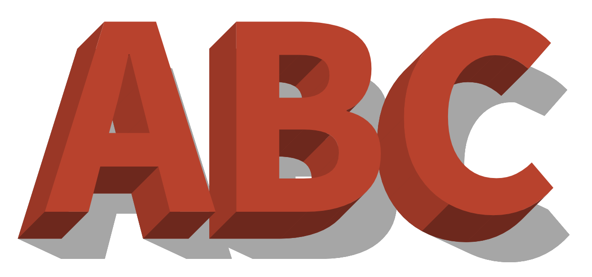
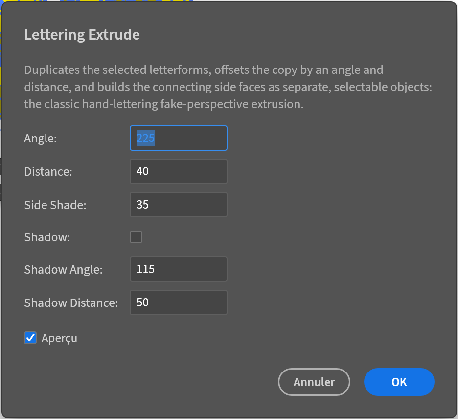
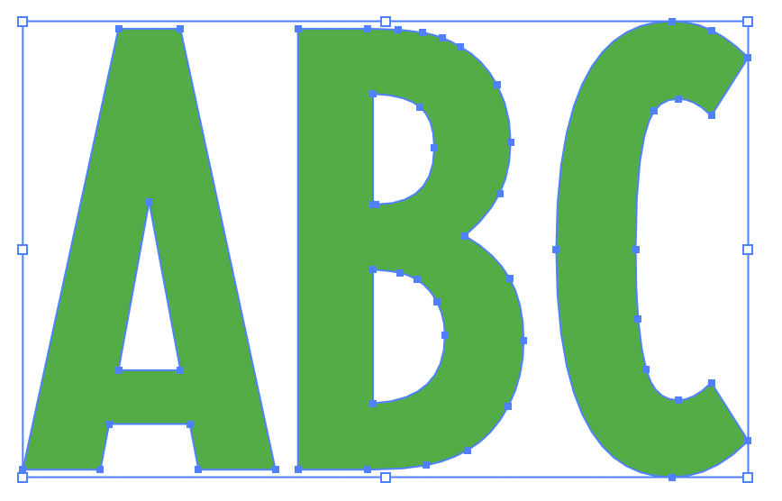
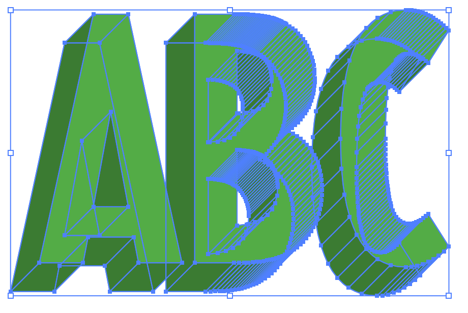
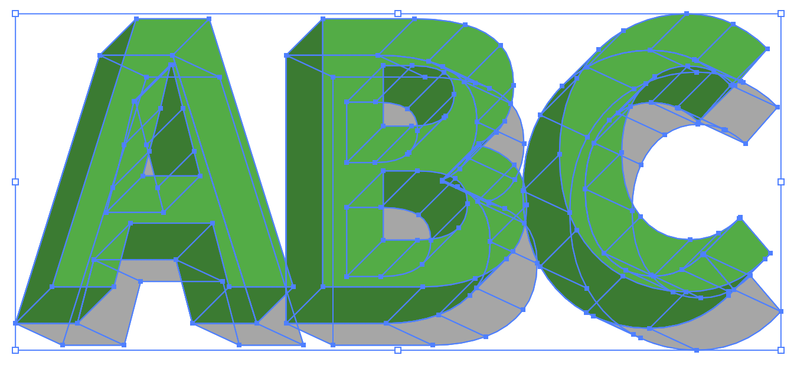

# Lettering Extrude — a VectorCraft plug-in

[🇬🇧 English](#english) · [🇫🇷 Français](#français)

A free, open-source plug-in for [VectorCraft](https://getartcraft.com/apps/vectorcraft) that
extrudes lettering and custom shapes the way sign painters and lettering artists have always done
it by hand: duplicate the letterform, offset the copy, and connect the two with clean side faces —
no 3D distortion, no warped letterforms. Made by [Club Lettreurs](https://www.clublettreurs.com).

<p align="center"></p>

---

## English

### What is VectorCraft?

[VectorCraft](https://getartcraft.com/apps/vectorcraft) ([source](https://github.com/storytold/vectorcraft))
is a free, open-source, clean-room vector illustration app written in Rust, built as an alternative
to Adobe Illustrator: Pen and Direct Selection tools, Pathfinder, gradients, Live Blends, a
Perspective Grid, SVG/PDF/EPS import and export, and more — running natively on macOS, Windows,
Linux and the web. It also supports sandboxed **WebAssembly plug-ins**, which is what this project
builds.

### What does this plug-in do?

Lettering Extrude reproduces the classic hand-lettering "fake perspective" extrusion: pick an angle
and a distance, and it duplicates your selected letterforms, offsets the copy, and builds the
connecting side faces as separate, selectable objects — each one its own path, so you can select,
recolour or delete any single face afterwards. Unlike a true 3D extrude effect, the front face of
the letter is never rotated or distorted: it stays exactly where you drew it.

<p align="center">
  
  
  
  
</p>

- **Angle** — the direction of the extrusion, as a compass bearing: 0°/360° North (up), 90° East
  (right), 180° South (down), 270° West (left), clockwise. Default **225°**.
- **Distance** — how deep the extrusion goes, in points. Default **40**.
- **Side Shade** — how much the side faces are darkened towards black, 0–100%. Default **35%**.
- **Shadow** — an optional cast shadow: the back face is extruded a second time, towards its own
  angle and distance, and everything (every letter's back face, its own extrusion and the
  connecting bands) is merged into one single shape placed behind everything else. Off by default.
  - **Shadow Angle** — compass bearing of the cast shadow. Default **115°**.
  - **Shadow Distance** — how far the cast shadow reaches, in points. Default **50**.
  - The shadow's grey matches the Side Shade intensity.

Curved letterforms are followed exactly (not approximated with straight segments), and several
letters can be extruded together in one run: later letters never cover an earlier letter's face,
however the angle is set.

**Known limitation:** a curved side band is split only where it mathematically has to be (where
the curve's own tangent lines up with the extrusion direction), which keeps clean curves clean and
lightweight. A handful of fonts draw their curves with unusual or poorly-placed anchors/handles
(not a true smooth curve), which can occasionally still show a small artefact on a side band in
those spots — this comes from the font's own outline, not from the selection or the parameters.

### Download

Grab the latest compiled plug-in here — no build tools needed:

**[⬇️ Download letter-extrude.wasm](https://github.com/clublettreurs/letter-extrude/releases/latest/download/letter-extrude.wasm)**
(always the latest release; see [all releases](https://github.com/clublettreurs/letter-extrude/releases) for older versions and notes)

### Install

1. Download `letter-extrude.wasm` (above).
2. In VectorCraft: **File › Open** the `.wasm` file, or set **Preferences › Performance & Storage ›
   Additional Plug-ins Folder** to a folder containing it (every `.wasm` there loads automatically).
3. Select one or more letterforms (paths or compound paths — convert type to outlines first), then
   run **Object › Plug-ins › Lettering Extrude…**. A dialog with a live preview lets you adjust the
   parameters above before confirming.

### Build from source

```sh
rustup target add wasm32-unknown-unknown
git clone https://github.com/clublettreurs/letter-extrude.git
cd letter-extrude
sh build.sh   # → dist/letter-extrude.wasm
```

`cargo test` runs the plug-in's own unit tests natively (no `.wasm` build needed for that).

### Support

If this plug-in is useful to you, consider buying the club a coffee:

[](https://buymeacoffee.com/clublettreurs)

**[buymeacoffee.com/clublettreurs](https://buymeacoffee.com/clublettreurs)**

### License

MIT — see [LICENSE](LICENSE).

---

## Français

### Qu'est-ce que VectorCraft ?

[VectorCraft](https://getartcraft.com/apps/vectorcraft) ([code source](https://github.com/storytold/vectorcraft))
est un logiciel de dessin vectoriel gratuit et open-source, écrit en Rust, pensé comme une
alternative à Adobe Illustrator : plume et sélection directe, Pathfinder, dégradés, fondus
(« Live Blends »), grille de perspective, import/export SVG/PDF/EPS, etc. — disponible nativement
sur macOS, Windows, Linux et sur le web. Il prend aussi en charge des **plugins WebAssembly**
exécutés dans un bac à sable, ce qui est exactement ce que ce projet construit.

### Que fait ce plugin ?

Lettering Extrude reproduit la technique classique d'extrusion « fausse perspective » utilisée à la
main par les lettreurs : on choisit un angle et une distance, et le plugin duplique les lettres
sélectionnées, décale la copie, puis construit les faces latérales de liaison comme des objets
séparés et sélectionnables — chacune est son propre chemin, qu'on peut sélectionner, recolorer ou
supprimer ensuite individuellement. Contrairement à un véritable effet d'extrusion 3D, la face
avant de la lettre n'est jamais tournée ni déformée : elle reste exactement là où elle a été
dessinée.

<p align="center">
  
  
  
  
</p>

- **Angle** — la direction de l'extrusion, en cap de boussole : 0°/360° Nord (haut), 90° Est
  (droite), 180° Sud (bas), 270° Ouest (gauche), sens horaire. Par défaut **225°**.
- **Distance** — la profondeur de l'extrusion, en points. Par défaut **40**.
- **Side Shade** (teinte des faces latérales) — à quel point les faces latérales sont assombries
  vers le noir, 0–100 %. Par défaut **35 %**.
- **Shadow** (ombre portée) — une ombre portée facultative : la face arrière est elle-même extrudée
  une seconde fois, selon son propre angle et sa propre distance, et le tout (face arrière, sa
  propre extrusion et les bandes de liaison, pour chaque lettre) est fusionné en une seule forme
  placée tout en arrière-plan. Désactivée par défaut.
  - **Shadow Angle** — cap de boussole de l'ombre portée. Par défaut **115°**.
  - **Shadow Distance** — profondeur de l'ombre portée, en points. Par défaut **50**.
  - Le gris de l'ombre reprend l'intensité de Side Shade.

Les lettres courbes sont suivies exactement (pas approximées par des segments droits), et plusieurs
lettres peuvent être extrudées en une seule fois : une lettre suivante ne recouvre jamais la face
d'une lettre précédente, quel que soit l'angle choisi.

**Limite connue :** une bande latérale courbe n'est découpée que là où c'est mathématiquement
nécessaire (là où la tangente de la courbe s'aligne avec la direction d'extrusion), ce qui garde les
courbes propres et légères. Certaines fontes dessinent leurs courbes avec des poignées mal placées
ou inhabituelles (pas une vraie courbe lisse), ce qui peut occasionnellement encore laisser un petit
défaut visuel sur une bande à cet endroit — cela vient du tracé d'origine de la fonte, pas de la
sélection ni des paramètres.

### Télécharger

Le plugin compilé, prêt à l'emploi — aucun outil de compilation nécessaire :

**[⬇️ Télécharger letter-extrude.wasm](https://github.com/clublettreurs/letter-extrude/releases/latest/download/letter-extrude.wasm)**
(toujours la dernière version ; voir [toutes les releases](https://github.com/clublettreurs/letter-extrude/releases) pour les versions précédentes et leurs notes)

### Installer

1. Téléchargez `letter-extrude.wasm` (ci-dessus).
2. Dans VectorCraft : **File › Open** le fichier `.wasm`, ou réglez **Preferences › Performance &
   Storage › Additional Plug-ins Folder** sur un dossier qui le contient (tout `.wasm` qui s'y
   trouve se charge automatiquement).
3. Sélectionnez une ou plusieurs lettres (chemins ou chemins composés — convertissez d'abord le
   texte en tracés), puis lancez **Object › Plug-ins › Lettering Extrude…**. Un dialogue avec
   aperçu en direct permet d'ajuster les paramètres ci-dessus avant de valider.

### Compiler depuis les sources

```sh
rustup target add wasm32-unknown-unknown
git clone https://github.com/clublettreurs/letter-extrude.git
cd letter-extrude
sh build.sh   # → dist/letter-extrude.wasm
```

`cargo test` lance les tests unitaires du plugin nativement (pas besoin de compiler le `.wasm` pour
ça).

### Soutenir le projet

Si ce plugin vous est utile, vous pouvez offrir un café au club :

[](https://buymeacoffee.com/clublettreurs)

**[buymeacoffee.com/clublettreurs](https://buymeacoffee.com/clublettreurs)**

### Licence

MIT — voir [LICENSE](LICENSE).
